# Saans — know your air, decide your day

Real-time air quality intelligence for any city, built for the **Lets Code Diwali Challenge 2026: BREATHE BETTER**.

Saans (सांस, "breath") is not another static AQI number. It tells you what the air is, **how trustworthy that number is**, where it is worst, what is coming, and what to do about it. Every number on screen carries a **provenance badge**, so a station measurement, a model estimate, a forecast, a computed value and an ML prediction can never be confused.

| Dashboard | Map | History |
| --- | --- | --- |
| 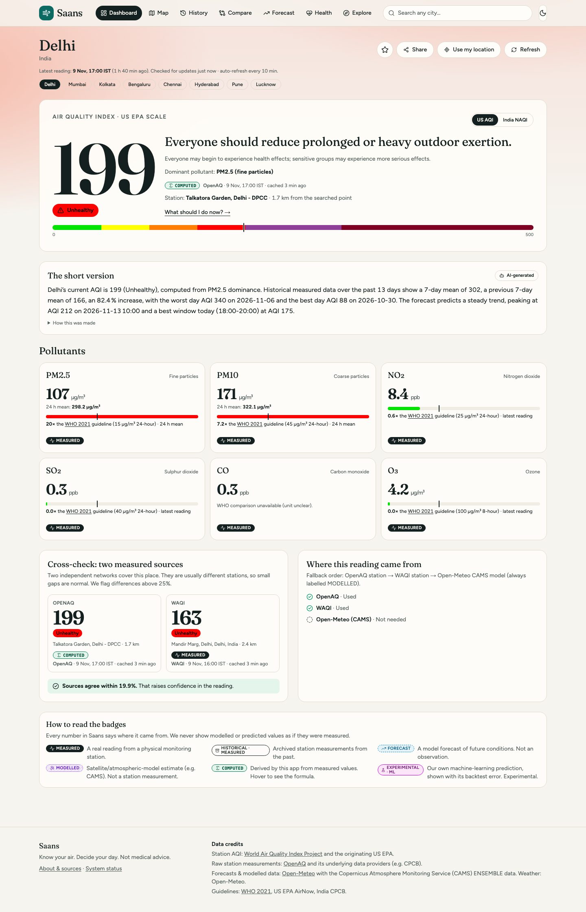 | 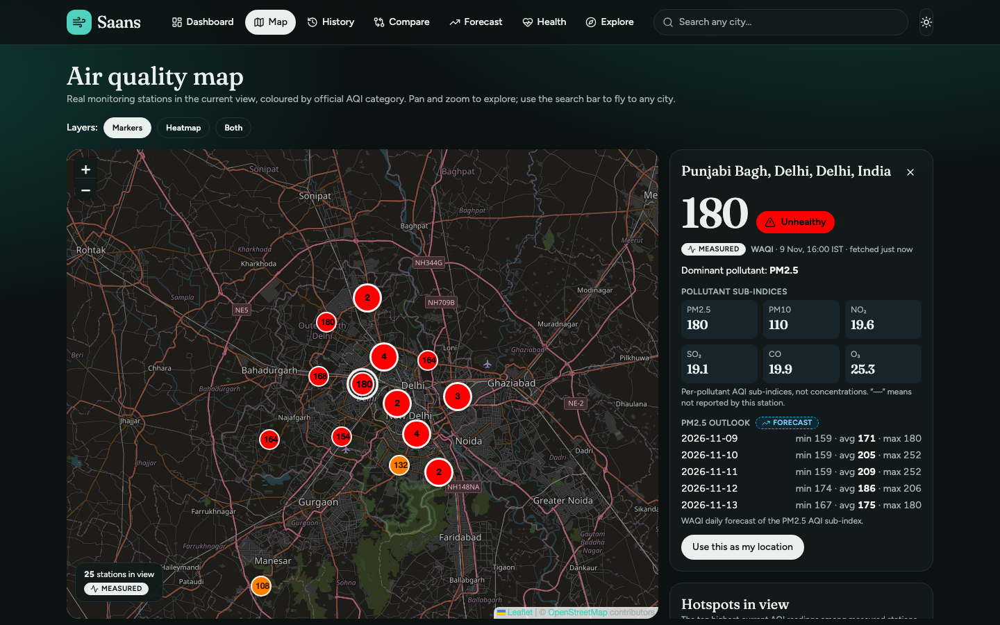 | 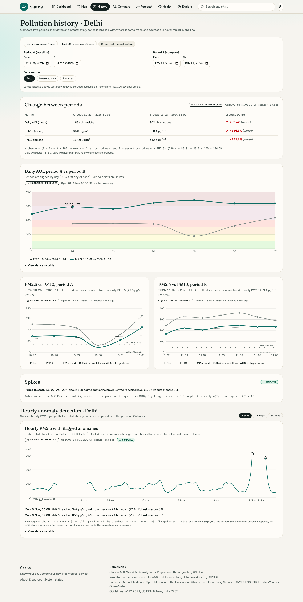 |

| Compare | Forecast | Health |
| --- | --- | --- |
| 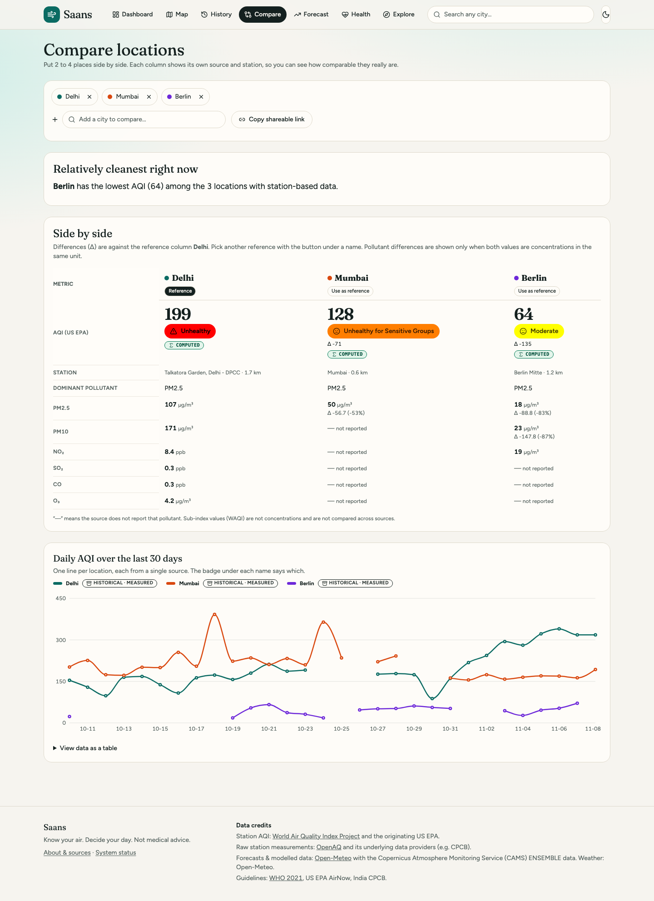 | 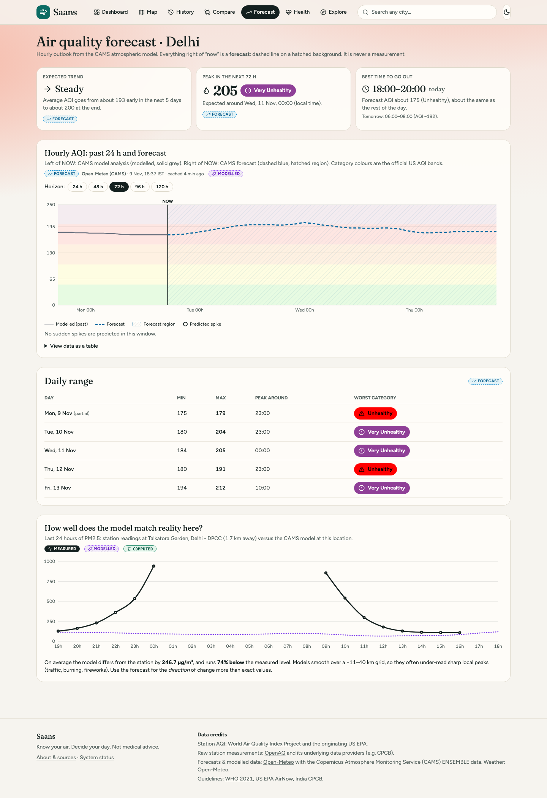 | 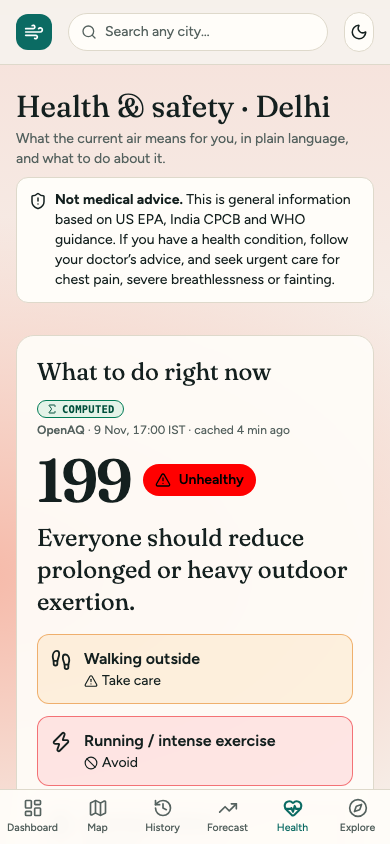 |

| Assistant | ML prediction | Diwali check |
| --- | --- | --- |
| 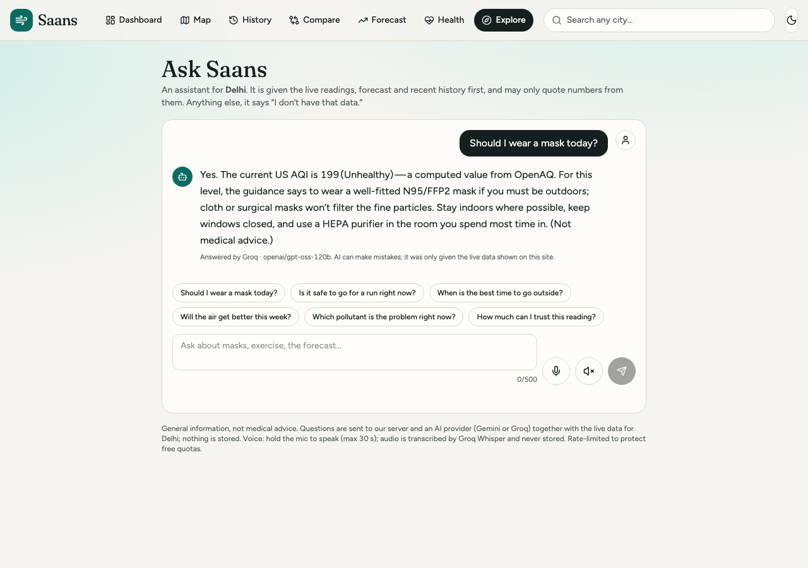 | 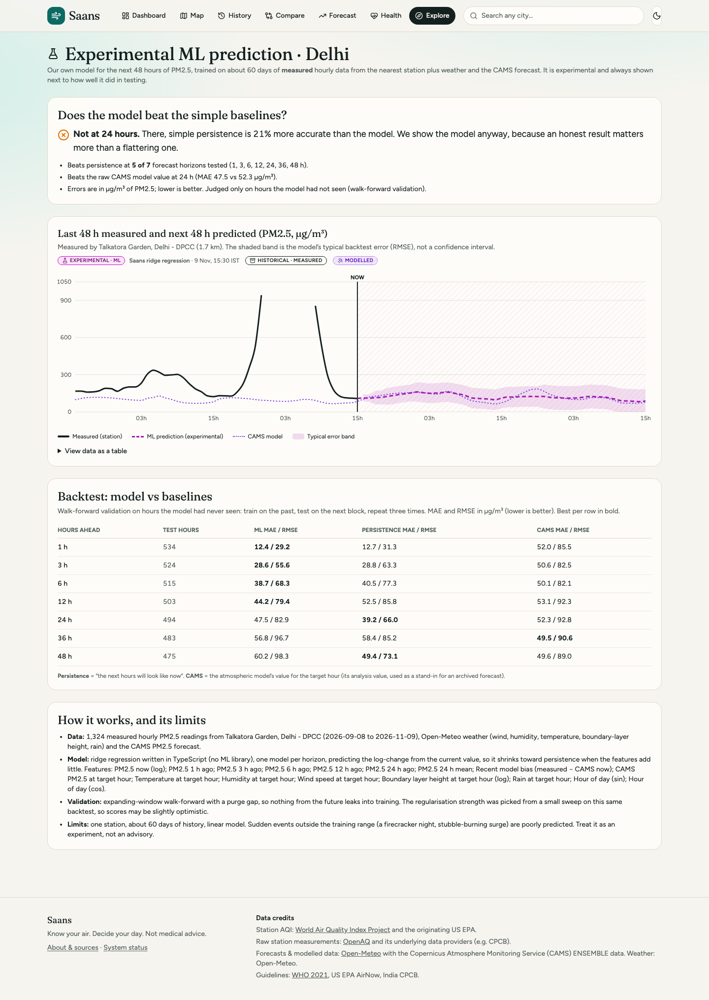 | 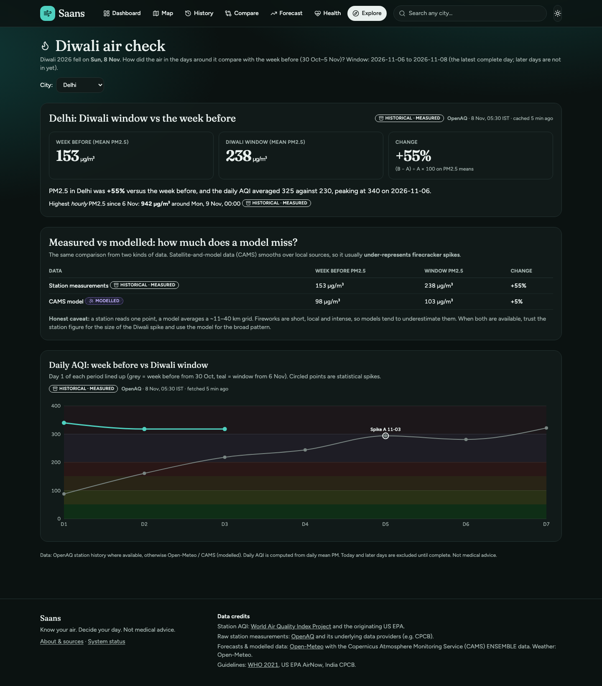 |

Dashboard on mobile (dark): 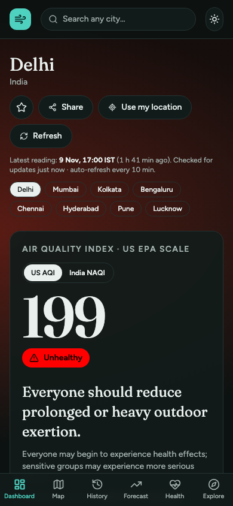

## Features

### The six core features

| Feature | What it does |
| --- | --- |
| **Live AQI dashboard** | Big AQI with category, colour and icon; PM2.5 / PM10 / NO₂ / SO₂ / CO / O₃ cards with WHO 2021 ratios and honest "not reported" states; dominant pollutant; nearest station and its distance; US AQI ⇄ India NAQI (PM-only) toggle; auto-refresh every 10 min with a truthful "last updated"; two-source cross-check that flags disagreement above 25%. |
| **Interactive map** | Real stations in the current viewport (refetched on pan/zoom, clustered when dense), official AQI colours, station side panel, ranked hotspots, heatmap layer, keyboard-accessible table alternative. |
| **Historical tracker** | Two date ranges, daily AQI and PM2.5 vs PM10 charts, trend line, percent change with the formula shown, spikes annotated. Measured (OpenAQ) or modelled (CAMS) with a source toggle; sources are never spliced into one line. |
| **Location comparison** | 2–4 places side by side with deltas against a chosen reference, an overlaid 30-day trend, a "relatively cleanest" call-out based only on available measurements, and a shareable `?locs=` URL. |
| **Health & safety** | Activity guidance for the current reading (walk, run, windows, mask, purifier), sensitive-groups panel, PM2.5 vs PM10 explainer, AQI and CPCB NAQI categories, best-time-to-go-out window from the forecast. *Not medical advice.* |
| **AQI forecast** | 24–120 h hourly forecast with a "NOW" divider, dashed line on a hatched region, expected trend, predicted spikes, daily min/max, and a model-vs-station check showing how well the model matches measurements at that place. |

### Bonus features

| Feature | What it does |
| --- | --- |
| **Location-based AQI** | "Use my location" with graceful denial and manual fallback; auto-detects only if permission was already granted (no unprompted dialog). |
| **Multi-API integration** | OpenAQ, WAQI, Open-Meteo (air quality, weather, geocoding), Gemini and Groq. A live fallback-chain panel on every dashboard and a `/status` page. |
| **Leaderboard** | 32 major cities (all Indian metros included) ranked by the mean AQI of their *live* stations; cities with no live station are listed separately as MODELLED, never ranked against measured ones. |
| **Clean air finder** | Cleanest measured stations within 10–100 km, with distance, compass direction and a "go there" link. |
| **Pollution heatmap** | `leaflet.heat` layer weighted by real station AQI, toggle with markers. |
| **Anomaly detection** | Rolling-median + MAD robust z-score on hourly PM2.5 history; flagged spikes on the chart with an explanation (COMPUTED badge). |
| **AI insights** | Short summaries grounded *only* in computed statistics, labelled "AI-generated", with a deterministic template fallback. |
| **AI assistant** | Streaming chat. The server fetches the real data first and passes it as a FACTS block; the model may only quote numbers from it and otherwise says "I don't have that data." Suggested questions, provider shown under every reply. |
| **Voice assistant** | Push-to-talk: `MediaRecorder` → server-side Groq Whisper (works in Chrome, Safari, Firefox) → assistant → `speechSynthesis`. Falls back to the browser `SpeechRecognition` API, otherwise explains that voice is unsupported. |
| **Smart alerts** | Per-place AQI thresholds in `localStorage`, in-app toasts and browser notifications. **Alerts fire only while Saans is open in a browser tab** (no background push). |
| **Sharing cards** | Server-rendered PNG (wide and square) with AQI, category, place, source and time; download, Web Share API, copy link; per-location Open Graph images. |
| **Impact report** | Automated period report: average, best and worst day, days above the WHO 24 h guideline, trend, spikes, cigarette-equivalent heuristic (Berkeley Earth, labelled "rough heuristic"). Printable (print stylesheet → PDF) and copy-as-text. |
| **ML prediction** | Ridge regression written in TypeScript: next 48 h of PM2.5 from ~60 days of measured hourly data plus weather and the CAMS forecast. Walk-forward validation, MAE/RMSE shown next to persistence and CAMS baselines, and an explicit verdict, including when it does **not** beat persistence. Badge `EXPERIMENTAL · ML`. |
| **Diwali air check** | Window around Diwali 2026 (Sun 8 Nov) vs the week before, measured and modelled side by side, with an honest caveat that models under-represent firecracker spikes. |
| **Also** | `/status` page, India NAQI toggle, WHO-guideline ratios, best-time planner, installable PWA (offline fallback; the service worker never caches API data). |

## The provenance policy (why you can trust the numbers)

| Badge | Meaning |
| --- | --- |
| `MEASURED` | A real reading from a physical monitoring station |
| `HISTORICAL · MEASURED` | Archived station data |
| `FORECAST` | A model forecast (dashed + hatched on charts) |
| `MODELLED` | Satellite / atmospheric-model estimate (CAMS) |
| `COMPUTED` | Derived by our code from measured values; the formula is shown on hover |
| `EXPERIMENTAL · ML` | Our own prediction, shown with its backtest error |

- No AQI or pollutant value is hard-coded, randomised or interpolated and presented as real. Missing values show **"—"** and the reason, never 0.
- Every badge shows the source, observation time with timezone, and "fetched N min ago". Readings older than 3 hours are flagged **STALE**; older than 6 hours they are not used as the headline.
- A particulate sensor stuck near zero for 12+ hours is treated as faulty and excluded, not shown as clean air.
- Both measured networks are shown when available and any disagreement above 25% is flagged.

## Data sources and credits

| Provider | Used for | Notes |
| --- | --- | --- |
| [OpenAQ v3](https://openaq.org) and its data providers (e.g. India CPCB) | Raw station concentrations, hourly + daily history | Needs `OPENAQ_API_KEY`. 60 req/min; headers are tracked on `/status`. |
| [World Air Quality Index Project](https://aqicn.org) and the originating US EPA | Station AQI, map station lists, daily forecast | Needs `WAQI_API_TOKEN`. Values are AQI **sub-indices**, not µg/m³. Cached for minutes only and never stored, per WAQI's terms. |
| [Open-Meteo](https://open-meteo.com) Air Quality + [CAMS](https://atmosphere.copernicus.eu) ENSEMBLE data | Forecast, modelled history, fallback | No key. Free for non-commercial use. Contains modified Copernicus Atmosphere Monitoring Service information. |
| Open-Meteo Weather and Geocoding | ML features, city search | No key |
| [Gemini](https://aistudio.google.com) and [Groq](https://groq.com) (free tiers) | Assistant, insights, Whisper transcription | Optional |
| [WHO 2021 guidelines](https://www.who.int/publications/i/item/9789240034228), US EPA AirNow, India CPCB | Standards and health guidance | Linked in the UI |
| © OpenStreetMap contributors, © CARTO | Map tiles | See "Map tiles" below |

**AQI standards.** Provider-supplied AQI is used where one exists. For OpenAQ raw data we compute the US AQI from PM2.5 and PM10 with the EPA **NowCast** method and the current EPA breakpoints (40 CFR Part 58 App. G, 2024 PM2.5 revision), labelled COMPUTED. The India NAQI toggle is **PM-only** (CPCB breakpoints on 24 h means). All breakpoints are unit-tested.

## AI features and safety

- **Providers** behind one interface, `LLM_PROVIDER=gemini|groq|auto|none`. In `auto`, Gemini is tried first, then Groq (`openai/gpt-oss-120b`, then `openai/gpt-oss-20b` on 429/quota). Failover happens on errors or an empty first token. All model ids are configurable by env.
- **Grounding.** The assistant never browses or guesses: the server builds a FACTS block from the live adapters (current reading, pollutants, forecast, 14-day history) and instructs the model to quote only those numbers.
- **No AI key works?** The assistant switches to a clearly labelled rule-based **basic mode** answering from the same real data; insights use deterministic templates.
- **Protection.** 500-character input cap, 500-token output cap, per-IP rate limit (8/min, 60/h), global daily cap `AI_DAILY_CAP`, audio ≤ 2 MB / 30 s and never stored. Secrets never appear in prompts or responses.

## Architecture

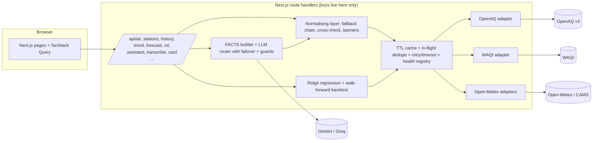

**Resilience.** Per-source fallback chain **OpenAQ measured → WAQI measured → Open-Meteo MODELLED** with a non-blocking banner naming what is degraded. Every upstream call has an 8 s timeout, honours `Retry-After` on HTTP 429, and retries with exponential backoff (max 2). Concurrent identical requests are de-duplicated. TTLs: live ≈ 8 min, forecast 30 min, history 6 h, WAQI 5 min only. If a provider fails the last cached copy is shown labelled "cached N min ago". All upstream payloads and route inputs are validated with zod.

## Run it locally

Requirements: Node 20.19+ (developed on Node 26), npm.

```bash
npm install
cp .env.example .env.local   # then fill in your keys
npm run check:env            # shows what is set / missing and what degrades
npm run dev                  # http://localhost:3000
```

| Script | Purpose |
| --- | --- |
| `npm run dev` / `build` / `start` | Next.js |
| `npm run typecheck` / `lint` | TypeScript strict, ESLint |
| `npm test` | Unit tests (offline): AQI breakpoints, NowCast, NAQI, WHO, stats/spikes, ridge regression, walk-forward backtest, cache/retry, rate limits, failover order, basic mode |
| `npm run test:live` | Adapter tests against the real APIs (needs keys) |
| `npm run check:env` | Reports set/missing variables (booleans only) |
| `npm run screenshots` | Captures `docs/screenshots/` with Playwright against a running instance |

### Environment variables

| Variable | Powers | Required | Get it |
| --- | --- | --- | --- |
| `OPENAQ_API_KEY` | Measured concentrations, history, ML | Recommended | <https://explore.openaq.org/register> |
| `WAQI_API_TOKEN` | Map, leaderboard, clean-air finder, station AQI | Recommended | <https://aqicn.org/data-platform/token> |
| `GEMINI_API_KEY` | AI assistant / insights (primary) | Optional | <https://aistudio.google.com/app/apikey> |
| `GROQ_API_KEY` | AI failover + Whisper voice transcription | Optional | <https://console.groq.com/keys> |
| `LLM_PROVIDER` | `auto` (default) \| `gemini` \| `groq` \| `none` | Optional | – |
| `GEMINI_MODEL`, `GROQ_MODEL`, `GROQ_FALLBACK_MODEL`, `GROQ_WHISPER_MODEL` | Model ids | Optional | defaults in `.env.example` |
| `AI_DAILY_CAP` | Global daily cap on AI + transcription calls | Optional | default 500 |
| `NEXT_PUBLIC_CARTO_KEY` | CARTO basemap tiles (public by design) | Optional | <https://carto.com/basemaps/apikey> |
| `NEXT_PUBLIC_SITE_URL` | Absolute URLs for Open Graph | Optional | your deployed URL |

Secrets are only read in server route handlers and never sent to the browser. Without OpenAQ/WAQI keys the app still works: it falls back down the chain and says so.

### Map tiles

CARTO raster tiles require a free key since September 2026. If `NEXT_PUBLIC_CARTO_KEY` is set the map uses CARTO; otherwise it falls back to OpenStreetMap tiles with correct attribution. The CARTO key is public by design (it appears in tile URLs), so it is the one `NEXT_PUBLIC_` credential.

## Deploy (Vercel)

1. Push the repo to GitHub and import it in Vercel (framework: Next.js, no build overrides).
2. In **Project Settings → Environment Variables** add the variables above (paste the values in the dashboard).
3. Redeploy, then open `/status` and confirm every provider is "Operational".

## Quality

- **Tests:** 86 unit tests (offline) plus live adapter tests; `typecheck`, `lint` and `build` are green.
- **Lighthouse** (mobile emulation, local production build): Accessibility **100** and SEO **100** on all 16 pages, Best Practices 96–100, Performance 66–100 (lowest on the map and ML pages, which are JS- and data-heavy).
- **Accessibility:** semantic HTML, focus rings, AA-checked category colours (tested), colour never the only signal (label + icon), keyboard-operable controls, a data-table alternative for the map and every chart, `aria-live` regions, reduced-motion support.
- **Responsive:** checked at 375, 768 and 1440 px with no horizontal scroll and no console errors on every page; bottom tab bar on mobile; light and dark themes.
- **Degradation tested:** each key removed or invalidated in turn (OpenAQ, WAQI, Gemini, Groq, all LLM keys, `LLM_PROVIDER=none`) with correct banners, failover and basic-mode behaviour.

## Limitations (honest notes)

- Stations are sparse in many places; the nearest may be kilometres away. Some networks have no active stations in some cities at times (e.g. WAQI lists no current Mumbai or Pune stations); Saans then falls back and says so.
- CAMS model data smooths over a ~11–40 km grid and under-reads local peaks (traffic, burning, firecrackers). The Forecast and Diwali pages show the measured-vs-model gap.
- The India NAQI is PM-only. The AQI for OpenAQ stations is computed from PM2.5/PM10 only (gases are shown but not part of the headline number).
- The ML model is experimental: one station, ~60 days, linear. It does not always beat persistence (the UI says so), and its regularisation was chosen on the same backtest, so scores can be slightly optimistic.
- Alerts work only while the app is open. Server cache, rate limits and health counters are per serverless instance.
- Not medical advice.

## Project structure

```text
src/
  app/            routes: pages + /api route handlers
  components/     dashboard, map, history, compare, forecast, health, explore, assistant,
                  alerts, report, prediction, diwali, charts, layout, ui
  lib/
    aqi/          EPA / CPCB / WHO logic, NowCast, stats (unit-tested)
    net/          cache, in-flight dedupe, retry/timeout, health registry
    sources/      one typed adapter per provider + normalising layer + feature queries
    llm/          providers, failover router, guards, FACTS builder, basic mode, insights
    ml/           ridge regression, features, walk-forward backtest, pipeline
scripts/          check-env, screenshots
docs/screenshots/ README images
```
