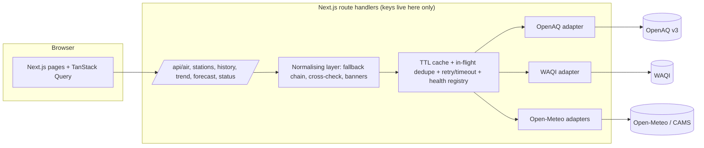

# Saans — know your air, decide your day

Real-time air quality intelligence for any city, built for the **Lets Code Diwali Challenge 2026: BREATHE BETTER**.

Saans (सांस, "breath") is not another static AQI number. It tells you what the air is, how trustworthy that number is, where it is worst, what is coming, and what to do about it. **Every number on screen carries a provenance badge**, so measured, modelled, forecast and computed values can never be confused.

## Features

| Feature | What it does |
| --- | --- |
| **Live AQI dashboard** | Big AQI with category and colour, PM2.5 / PM10 / NO₂ / SO₂ / CO / O₃ cards with WHO 2021 ratios, dominant pollutant, nearest station and distance, US AQI ⇄ India NAQI (PM-only) toggle, auto-refresh every 10 min with a truthful "last updated". Cross-checks two measured sources and flags disagreement above 25%. |
| **Interactive map** | Real stations in the current viewport (refetched on pan/zoom, clustered when dense), official AQI colours, station side panel with sub-indices and outlook, ranked hotspots, keyboard-accessible table alternative. |
| **Historical tracker** | Two date ranges, daily AQI and PM2.5 vs PM10 charts, least-squares trend line, percent change with the formula shown, spikes annotated. Measured (OpenAQ) or modelled (CAMS) with a source toggle; sources are never spliced into one line. |
| **Location comparison** | 2–4 places side by side with deltas against a chosen reference, an overlaid 30-day trend, a "relatively cleanest" call-out based only on available measurements, and a shareable `?locs=` URL. |
| **Health & safety** | Activity guidance for the current reading (walk, run, windows, mask, purifier), sensitive-groups panel, PM2.5 vs PM10 explainer, AQI and CPCB NAQI categories, and a best-time-to-go-out window computed from the forecast. Not medical advice. |
| **AQI forecast** | 24–120 h hourly forecast with a "NOW" divider, dashed line and hatched forecast region, expected trend, predicted spikes, daily min/max, and a model-vs-station check showing how well the model matches measurements here. |
| **System status** | `/status` shows live health, latency, last success and rate-limit headroom for each upstream, and which env keys are set (booleans only). |

## The provenance policy (why you can trust the numbers)

| Badge | Meaning |
| --- | --- |
| `MEASURED` | A real reading from a physical monitoring station |
| `HISTORICAL · MEASURED` | Archived station data |
| `FORECAST` | A model forecast (dashed + hatched on charts) |
| `MODELLED` | Satellite / atmospheric-model estimate (CAMS) |
| `COMPUTED` | Derived by our code from measured values; the formula is shown on hover |
| `EXPERIMENTAL · ML` | Our own prediction, shown with its backtest error |

- No AQI or pollutant value is hard-coded, randomised or interpolated and presented as real. Missing values show **"—"** and the reason, never 0.
- Every badge shows the source, observation time with timezone, and "fetched N min ago". Readings older than 3 hours are flagged **STALE**.
- A flat-zero particulate sensor is treated as faulty and excluded rather than shown as clean air.

## Data sources and credits

| Provider | Used for | Notes |
| --- | --- | --- |
| [OpenAQ v3](https://openaq.org) and its data providers (e.g. India CPCB) | Raw station concentrations, hourly + daily history | Needs `OPENAQ_API_KEY`. 60 req/min; headers are tracked on `/status`. |
| [World Air Quality Index Project](https://aqicn.org) and the originating US EPA | Station AQI, map station lists, daily forecast | Needs `WAQI_API_TOKEN`. Values are AQI **sub-indices**, not µg/m³. Cached for minutes only and never stored, per WAQI's terms. |
| [Open-Meteo](https://open-meteo.com) Air Quality + [CAMS](https://atmosphere.copernicus.eu) ENSEMBLE data | Forecast, modelled history, fallback | No key. Free for non-commercial use. Contains modified Copernicus Atmosphere Monitoring Service information. |
| Open-Meteo Geocoding | City search | No key |
| [WHO 2021 guidelines](https://www.who.int/publications/i/item/9789240034228), US EPA AirNow, India CPCB | Standards and health guidance | Linked in the UI |
| © OpenStreetMap contributors, © CARTO | Map tiles | See "Map tiles" below |

**AQI standards.** Provider-supplied AQI is used where one exists. For OpenAQ raw data we compute the US AQI from PM2.5 and PM10 with the EPA NowCast method and the current EPA breakpoints (40 CFR Part 58 App. G, 2024 PM2.5 revision), labelled COMPUTED. The India NAQI toggle is **PM-only** (CPCB breakpoints on 24 h means).

## Architecture



Fallback chain per location: **OpenAQ measured → WAQI measured → Open-Meteo MODELLED**, with a non-blocking banner naming the degraded source. If a provider fails, the last cached copy is shown labelled "cached N min ago". All upstream payloads and all route inputs are validated with zod.

## Run it locally

Requirements: Node 20.19+ (tested on Node 26), npm.

```bash
npm install
cp .env.example .env.local   # then fill in your keys
npm run check:env            # shows what is set / missing and what degrades
npm run dev                  # http://localhost:3000
```

Scripts: `dev`, `build`, `start`, `typecheck`, `lint`, `test` (unit tests, offline), `test:live` (adapter tests against the real APIs, needs keys), `check:env`, `screenshots`.

### Environment variables

| Variable | Powers | Required | Get it |
| --- | --- | --- | --- |
| `OPENAQ_API_KEY` | Measured concentrations, history | Recommended | https://explore.openaq.org/register |
| `WAQI_API_TOKEN` | Map, station AQI, WAQI forecast | Recommended | https://aqicn.org/data-platform/token |
| `GEMINI_API_KEY`, `GROQ_API_KEY` | AI features (optional) | Optional | https://aistudio.google.com/app/apikey, https://console.groq.com/keys |
| `NEXT_PUBLIC_CARTO_KEY` | CARTO basemap tiles | Optional (public by design) | https://carto.com/basemaps/apikey |
| `NEXT_PUBLIC_SITE_URL` | Absolute URLs for Open Graph | Optional | your deployed URL |

Secrets are only read in server route handlers and are never sent to the browser. Without OpenAQ/WAQI keys the app still works: it falls back to modelled data and says so.

### Map tiles

CARTO raster tiles require a free key since September 2026. If `NEXT_PUBLIC_CARTO_KEY` is set the map uses CARTO; otherwise it falls back to OpenStreetMap tiles with correct attribution. The CARTO key is public by design (it appears in tile URLs), so it is the one `NEXT_PUBLIC_` variable.

## Deploy (Vercel)

1. Push the repo to GitHub and import it in Vercel (framework: Next.js, no build overrides).
2. In **Project Settings → Environment Variables** add the variables above (names only here; paste values in the dashboard).
3. Redeploy, then open `/status` and confirm every provider is "Operational".

## Limitations (honest notes)

- Stations are sparse in many places; the nearest may be kilometres away.
- Some networks have no active stations in some cities at times (e.g. WAQI lists no current Mumbai stations); Saans then falls back and says so.
- CAMS model data smooths over a ~11–40 km grid and under-reads local peaks (traffic, burning, firecrackers). The Forecast page shows the measured-vs-model gap.
- Server cache and health counters are per serverless instance.
- Not medical advice.

## Project structure

```
src/
  app/            routes (pages + /api route handlers)
  components/     UI (dashboard, map, history, compare, forecast, health, charts, layout, ui)
  lib/
    aqi/          EPA / CPCB / WHO logic, NowCast, stats (unit-tested)
    net/          cache, in-flight dedupe, retry/timeout, health registry
    sources/      one typed adapter per provider + normalising layer
```
